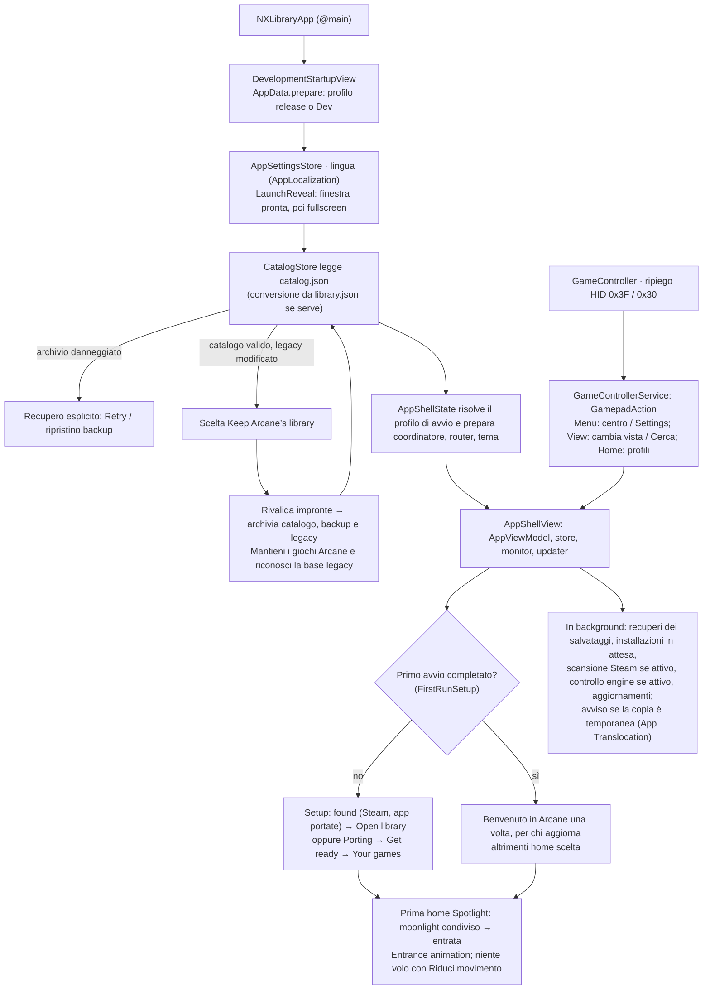
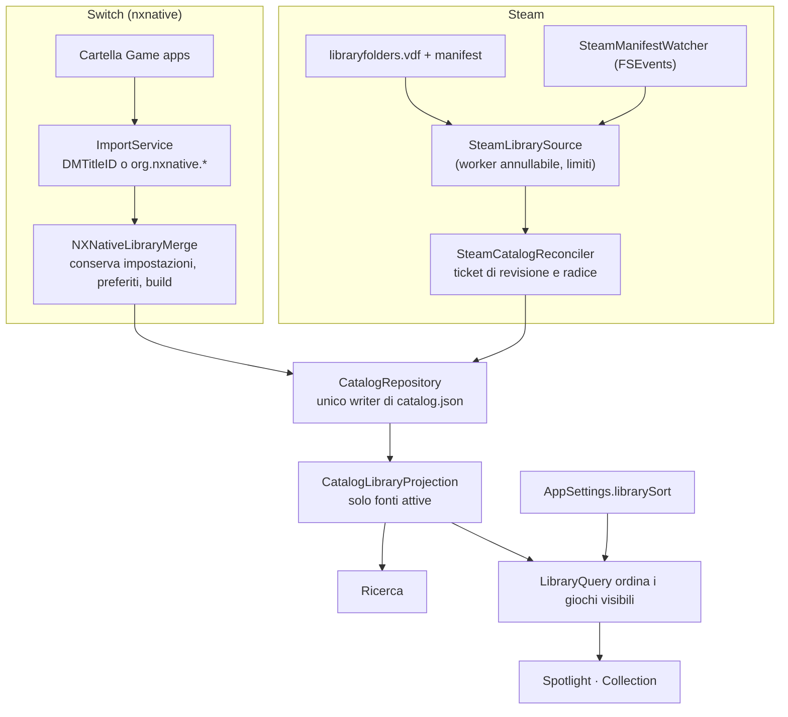
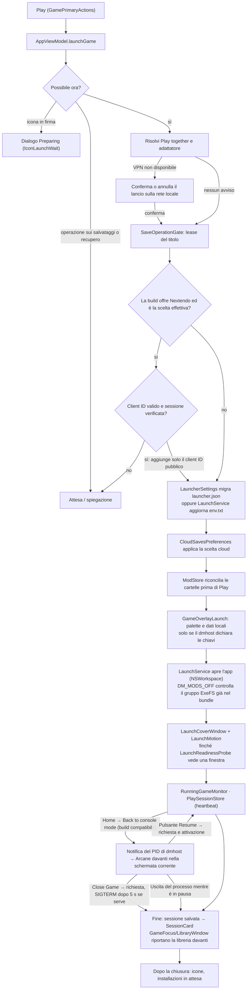
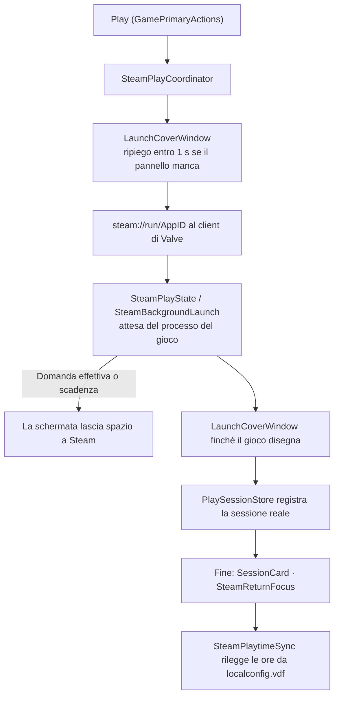
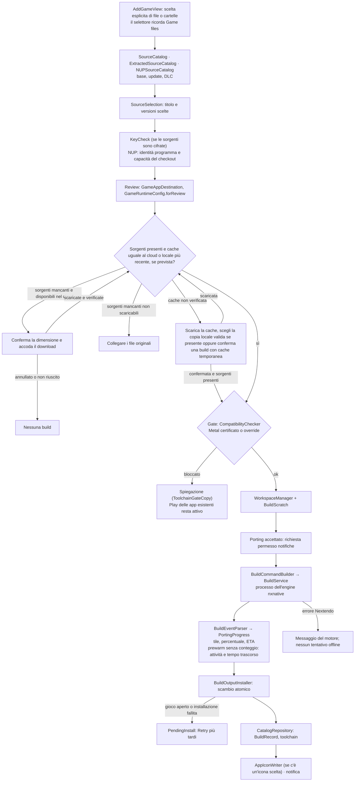
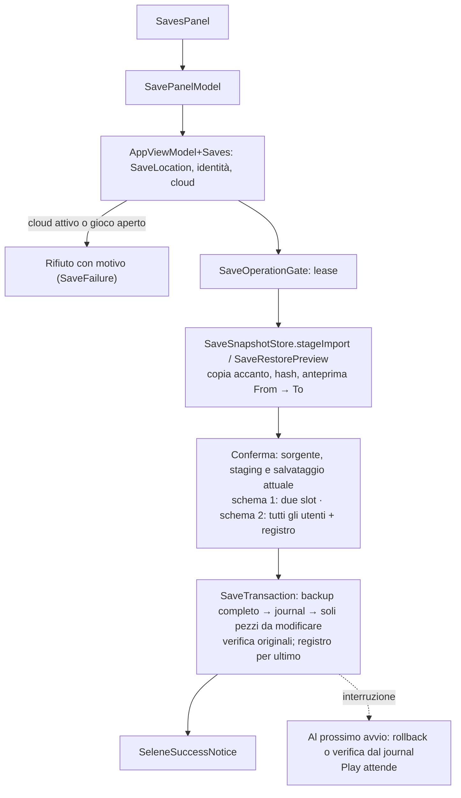
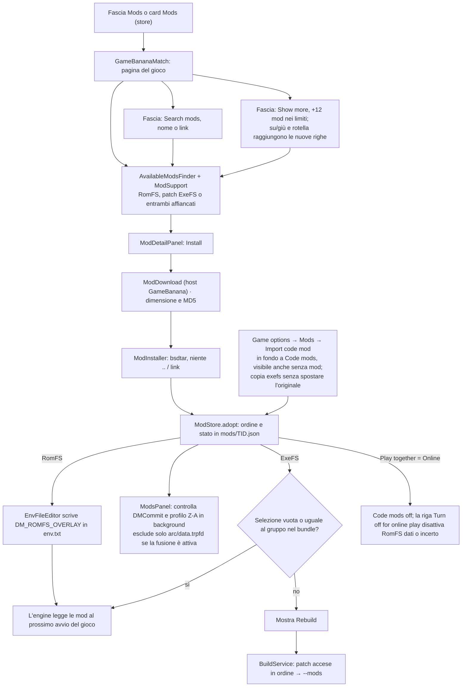
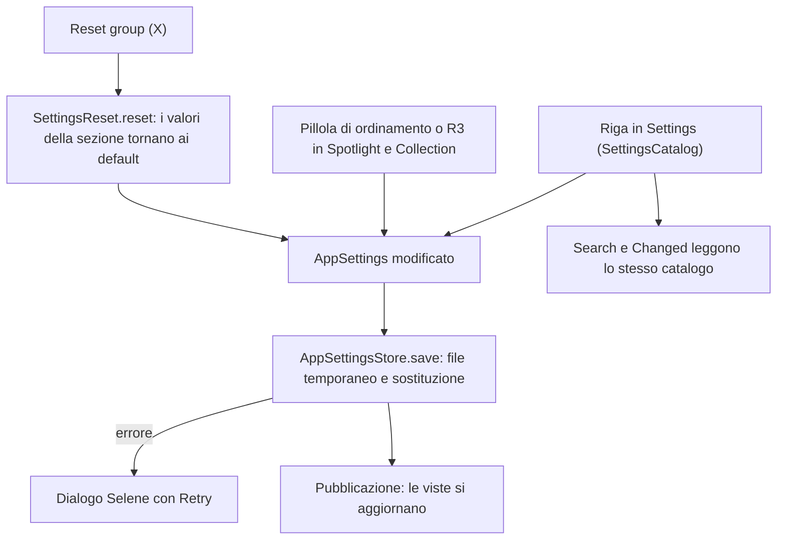
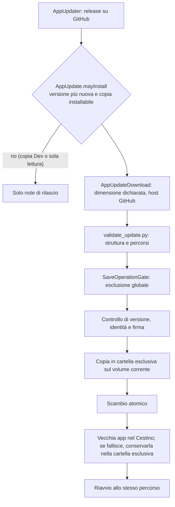

# Arcane — i flussi principali

Ogni flusso segue un'azione dall'input all'effetto, nominando i tipi che se ne occupano. I dettagli e le regole di ogni passo sono nella sezione dell'area in [architecture.md](architecture.md); come costruire un pezzo nuovo è in [conventions.md](../working-on-it/conventions.md). Se un flusso cambia, il suo schema si aggiorna nello stesso commit.

- [1. Avvio dell'app](#1-avvio-dellapp)
- [2. Dal disco alla libreria](#2-dal-disco-alla-libreria)
- [3. Play di un gioco Switch (nxnative)](#3-play-di-un-gioco-switch-nxnative)
- [4. Play di un gioco Steam](#4-play-di-un-gioco-steam)
- [5. Costruire un gioco Switch (Add Game)](#5-costruire-un-gioco-switch-add-game)
- [6. Importare o ripristinare un salvataggio](#6-importare-o-ripristinare-un-salvataggio)
- [7. Installare una mod](#7-installare-una-mod)
- [8. Cambiare un'impostazione](#8-cambiare-unimpostazione)
- [9. Aggiornare l'app](#9-aggiornare-lapp)

## 1. Avvio dell'app

Punti fissi:
- Gli store si costruiscono una volta sola, prima della shell.
- Un archivio illeggibile non diventa mai una libreria vuota.
- La Dev legge e scrive solo nel suo profilo.
- La scelta Steam del primo Setup resta salvata anche alla chiusura; lettura e attivazione usano la cartella scelta nella fonte. Una lettura incompleta offre Retry, senza dichiarare la libreria vuota.
- La cartella Game files ricordata resta una preferenza del selettore: l'avvio non ne enumera i sorgenti.
- La shell riceve gli stessi comandi dal profilo esteso GameController o, in sua assenza, da un pad HID Nintendo. Un pad dichiarato compatibile da macOS attende fino a due secondi prima del ripiego a HID.
- Menu e dialoghi nativi hanno precedenza sul routing della shell: `nativeDialogOwnsInput` ferma i comandi del controller anche se un benvenuto, Setup o dialogo dell'app è già aperto sotto.

## 2. Dal disco alla libreria

Punti fissi:
- Una scansione aggiorna solo ciò che ha osservato; un'assenza non cancella nulla.
- Un risultato superato da un cambio di cartella o di fonte non si applica.

## 3. Play di un gioco Switch (nxnative)

Play applica la scelta per gioco o il default globale. In Local usa l'adattatore VPN scelto o, se l'utente conferma l'avviso, la rete locale; il lancio non modifica le scelte salvate. I parametri espliciti di `env.txt` mantengono la precedenza.

## 4. Play di un gioco Steam

Arcane legge le domande dal log di Steam. Durante `ShowInterstitials` l'attesa prosegue e il client può aprire le sue finestre dietro la schermata. Arcane non scrive mai i file di Steam e non apre l'app del gioco direttamente. Dettagli in [steam.md](steam.md).

Nella pagina Spotlight di un titolo Steam, Giù porta anche a **More like this** quando la fascia è presente. Invio, A o doppio clic selezionano la copertina sulla riga della libreria. Se il filtro la esclude, la libreria passa a **All games** come per Switch.

## 5. Costruire un gioco Switch (Add Game)

**Add Game → Add ported app.** Scegli un bundle locale nel selettore oppure trascina un solo `.app` sulla schermata Add Game. Se la riga è disabilitata, il sottotitolo indica l'operazione in corso. Se il titolo esiste, Replace o Cancel decide se procedere. Arcane controlla lo spazio, ripara i metadati di trasferimento solo sulla copia e verifica identità e firma prima di pubblicarla in Game apps. La sorgente resta intatta e il titolo compare in libreria.

**Details → Options → Edit details → Attach sources.** Scegli i file originali o una cartella. La scansione usa le regole di Add Game e rifiuta le sorgenti che non producono un gioco compilabile con lo stesso title ID. Torna a Options → Rebuild: l'installazione riuscita sostituisce il bundle esistente, senza inviare nulla al cloud.

`BuildCommandBuilder` aggiunge `--nextendo` e l'ID pubblico all'ambiente solo se il checkout dichiara il flag e l'ID è configurato. La sessione serve al Play online, non al porting.

Durante un porting, B o Esc nasconde il pannello senza annullare il lavoro. Dopo il completamento o l'annullamento, B o Esc torna a Review se c'è una selezione nel wizard; da un Build o Rebuild aperto direttamente senza bozza, torna alla schermata di partenza.

**Menu → Centro attività.** La campanella si apre con un clic o con la selezione del menu (Menu sul controller, ⌘K da tastiera). Mostra l'azione e l'oggetto di ogni compilazione, trasferimento o spostamento cloud. Su/Giù sposta il focus; A, Invio o un clic su una riga di compilazione apre Porting. X, Canc o il pulsante tondo ferma il lavoro selezionato o rimuove la singola richiesta in coda. Nei Risultati, Retry (A/Invio) riaccoda lo stesso lavoro; Clear (X/Canc) rimuove la riga; Clear all (A/Invio) rimuove gli esiti senza annullare i lavori. B o Esc chiude senza fermarli.

Con un porting in corso, Build o Rebuild per un altro gioco accoda la richiesta; ripetere il comando per lo stesso gioco non crea duplicati. In Spotlight e Details la pillola primaria mostra lo stato in coda e diventa Annulla al focus o al passaggio del puntatore; A, Invio o clic rimuove la richiesta senza avviarla. Dalla riga delle copertine in Spotlight, A avvia ancora l'app già installata o porta alle azioni del gioco se manca. Al successo, errore o annullamento del porting attivo parte il primo in attesa e la sua pillola diventa Porting. Un titolo occupato da un trasferimento o da un lease aspetta il rilascio. Al riavvio la compilazione interrotta torna in testa. Se il gioco, i file sorgente o l'app da ricompilare non ci sono più, resta un errore nei Risultati e il lavoro non parte da solo.

**Details o Spotlight → Cloud.** Il badge accanto alle azioni principali, anche durante una compilazione o dopo un errore, e il link in fondo aprono lo stesso pannello; entrambi si possono nascondere in Settings. Al primo invio si scelgono app e cache di compilazione insieme se la cache esiste; altrimenti Send sulla riga dell'app pubblica l'app sola. Durante un invio completo la riga dell'app mostra «App pubblicata · invio della cache…» non appena l'app è disponibile per gli altri Mac.

Send copia file con rclone in una cartella di versione e riusa le copie già ricevute o identiche nella versione precedente. Pubblica un manifest in `<Titolo [ID]>/manifests/` per ogni parte nuova dopo verifica di dimensioni e MD5: prima l'app, poi la cache. Se il titolo cambia nome, Arcane riusa la cartella dallo stesso `[ID]`. Cancel conserva il manifest già pubblicato e i file ricevuti per Retry. Send è disponibile anche per una copia `.aar` sincronizzata, per migrarla senza cambiare i file locali. Le versioni precedenti, compresi i `.aar`, non vengono spostate né cancellate da Send.

Con solo una copia cloud dell'app, Download sostituisce il pulsante principale e usa lo stesso ripristino del pannello: riusa i file verificati, ripara l'app e verifica identità e firma prima di riattivare Play. Il download usa Game apps per un titolo importato e non richiede sorgenti, cache o una build. Dal browser si può scaricare `<Nome>.app`, estrarre lo ZIP e usare Add Game → Add ported app. Se la firma resta non valida dopo la riparazione, l'adozione ripiega su una firma ad hoc: se i manifest v2 del titolo esistono, ne richiede uno corrispondente; senza manifest v2 o connessione, l'esito mostra «Content not verified». La terza riga propone Send o Download per le sorgenti mancanti da un lato; con una divergenza non offre azioni.

Nel pannello Download si riempie con i byte ricevuti e li mostra una sola volta accanto al punto di stato. In Spotlight e Details una sola riga mostra fase e byte sotto Download. La barra resta quando il totale è ignoto o quando il pulsante non indica il progresso. Cancel rimane un'azione separata nel pannello.

Per un aggiornamento dal riferimento, la riga Cloud mostra i byte da scaricare sul totale. Dopo il download di app o cache, se la copia personale è precedente, la riga lo indica e propone Send come azione manuale.

Durante una partita si può inviare la sola app, se le normali regole di invio singolo lo consentono, e scaricarla dalla libreria personale o dal riferimento. Download resta pieno con «Pronta» dopo la verifica e il pannello Cloud e il centro attività mostrano «Aggiornamento pronto · si applica quando chiudi il gioco». Arcane applica la copia alla chiusura del gioco, anche se aperto dal Finder. Play aspetta se lo scambio è già in corso. Cache, Rebuild e Free up space richiedono il gioco chiuso.

Durante la verifica, la riga Rebuild mostra una barra Selene; un clic, A o Invio sulla riga oppure B/Esc con la riga selezionata annulla la verifica. Se l'inventario dei metadati conferma che l'ultima compilazione riuscita ha scritto la cache locale dopo il manifest, Rebuild la riusa senza calcolarne l'hash. Se un download lascia una cache parziale verificata, si può riprendere Download o lasciare che la build rigeneri il resto.

Se le copie differiscono e la data non dimostra che quella locale è più recente, il dialogo mette Download in testa e gli dà il focus, poi propone la cache di questo Mac, se valida, e Rebuild senza cache. Annulla è in fondo. Senza cache compatibile con l'app (motore e catena shader), Rebuild usa i file originali e una cache temporanea. Dopo l'installazione, un'app diversa dal manifest risulta «Newer on this Mac» e resta da inviare manualmente.

Free up space apre una conferma con le dimensioni e una selezione per app, cache e file del gioco. Solo le copie sincronizzate sono selezionabili; app e cache partono selezionate quando disponibili, i file del gioco no. La conferma precede una nuova verifica prima del Cestino. La voce di libreria resta e lo spazio ritorna quando si svuota il Cestino. Invio, download e liberazione passano per la stessa coda. Cancel rimuove la richiesta in coda o annulla quella attiva; B chiude solo il pannello.

**Uscire durante un trasferimento.** Cmd+Q, Quit nella barra menu, Power → Quit e la chiusura della finestra principale aprono la stessa conferma nella finestra. Resta ha il focus iniziale: chiude la conferma e lascia proseguire il lavoro. Quit ferma il trasferimento, attende la scrittura della coda e poi chiude l'app. Se un'app è pronta ma non ancora installata, Arcane pulisce il bundle temporaneo senza toccare quello installato. Al prossimo avvio riparte prima l'azione interrotta, riusando i file v2 verificabili, poi quelle in attesa. Arcane salta i giochi non più in catalogo e le azioni non più possibili; per la liberazione parziale verifica di nuovo solo ciò che può ancora andare nel Cestino. L'aggiornamento resta bloccato mentre ci sono trasferimenti.

Se al Build o Rebuild mancano file locali ma il cloud li ha, Arcane mostra la dimensione da scaricare. Download accoda il ripristino e apre il pannello di avanzamento. Solo il ripristino riuscito nella stessa sessione riprende il percorso di build, con i normali controlli per cache e toolchain.

L'apertura del pannello Cloud legge il manifest e confronta i contenuti locali; riusa le impronte di app e cache anche dopo un riavvio, se sono ancora valide. Come Resume, l'importazione, Free up space, Download e la migrazione `.aar`, il pannello usa il manifest più recente tra la cartella nominata e quella del solo ID. Se il demone rclone è indisponibile, i comandi singoli mantengono la distinzione tra copia assente e stato ignoto.

**Errori cloud.** Offline offre Retry; credenziali scadute o revocate riaprono il passo Account; cartella mancante riapre direttamente il passo Folder, sul percorso della libreria o dei file del gioco. Quota Drive esaurita apre la gestione dello spazio Google. Il Mac senza spazio offre Storage senza avviare il download. Se la coda non si salva, un avviso una tantum spiega che il lavoro continua ma potrebbe non riprendere dopo l'uscita.

**File del gioco (Porting).** Data la selezione del gioco, `CloudGameSources` riusa i file remoti con MD5 uguale e invia solo gli assenti; una divergenza blocca un nuovo invio. Il download conta i file mancanti con copia remota verificabile e controlla lo spazio totale prima del primo file. Per le sorgenti importate crea una cartella dedicata nel profilo, solo su richiesta di ripristino. Il ripristino pubblica ogni file verificato nella sua cartella; la liberazione sposta nel Cestino solo i file locali appena verificati. Un annullamento non annulla i file già pubblicati o spostati nel Cestino.

**Settings → Porting → Cloud library.** Dal pannello Cloud, Open settings apre la sezione se la libreria è spenta o non configurata. Stato mostra l'ultimo controllo reale, data e azione in caso di errore; Configure cloud library apre l'assistente. Seguono Cartelle, Importa, Aspetto e Avanzate. L'interruttore si applica senza riavvio. Aspetto cambia subito icona, link e badge con attenuazione delle copertine. Reset group ripristina solo queste scelte. Advanced si apre anche da un risultato pertinente in Search o Changed; contiene il client Google, l'eseguibile rclone, Test connection e Disconnect. Il test legge soltanto l'elenco della cartella. Dopo conferma, Disconnect elimina solo il remote dal file rclone locale.

**Prima connessione.** Sign in apre Google nel browser. Con il client incorporato non si compila il modulo; Advanced → Use another Google client lo riapre. Folder propone la prima libreria con manifest verificati in `Games` o in un suo figlio diretto, poi il percorso dei file del gioco se riconoscibile. Resume apre la cartella dei file proposta nel selettore Drive; Choose another folder riparte da My Drive. Se non trova una proposta, il selettore si apre su `<libreria>/GameFiles`, utilizzabile anche se non ancora creato. Continue ha il focus iniziale quando abilitato. Verify controlla la libreria e il percorso file esplicito. Solo Activate applica le preferenze e avvia l'importazione, senza spostare file.

**Cambiare cartella cloud.** In Folder, l'assistente mostra i giochi della cartella precedente quando può spostarli. Se non si seleziona lo spostamento, Activate cambia solo la preferenza. Se lo si seleziona, Activate chiede conferma con numero di giochi e dimensione. La barra avanza per file nell'assistente e nel centro attività; Cancel in entrambi ferma il lavoro tra due file. Con un conflitto o un'interruzione, la preferenza resta invariata ma i file già spostati restano nella nuova cartella. Un esito fallito offre Retry per la stessa destinazione; l'assistente permette di ripetere la scelta anche dopo un annullamento. L'assistente mostra il numero dei file in conflitto e il primo percorso per il suo tentativo. La cartella di origine non viene rimossa.

Lo spostamento riguarda solo i manifest e le copie di app e cache, non le sorgenti. Cartelle mostra entrambi i percorsi `remote:percorso` affiancati; entrambe le righe aprono direttamente Folder. Game files folder usa lo stesso selettore Drive della libreria e propone di riprendere i file riconosciuti. Si può anche scegliere Enter a path e salvare un percorso valido non ancora esistente, senza crearlo. Save cambia solo il percorso sullo stesso remote. La riga compare in Search e, quando il percorso è esplicito, in Changed. Il percorso esplicito resta invariato al cambio della libreria; quello predefinito segue la libreria (`GameFiles`). Details → Cloud mostra il percorso di ogni cartella determinabile. I giochi con i file locali nella stessa cartella usano sottocartelle distinte sul remote, identificate dal title ID base.

**Importazione dalla libreria cloud.** All'avvio o alla fine dell'assistente, e quando si riattiva la libreria, Arcane cerca manifest validi e aggiunge i giochi mancanti senza scaricare app o sorgenti. Se il manifest contiene la selezione delle sorgenti, Arcane registra i file selezionati e, per NUP, il programma Switch 2 del title ID esatto; un manifest precedente senza selezione non cambia comportamento. Import games from the cloud ripete la ricerca e ne mostra l'esito. Un gioco rimosso esplicitamente resta escluso. Un titolo importato compare con badge solo cloud; Download nelle viste della libreria e in Details diventa Play dopo il ripristino.

**Libreria di riferimento.** Condividi manualmente la cartella in Google Drive come Lettore con l'altro account. Su quel Mac, in Cloud library → Reference library, incolla il link o l'ID. Lo stato mostra la cartella, il conteggio e la verifica, oppure indica come recuperare l'accesso. I nuovi titoli usano le stesse tessere. In Details → Cloud, la riga di aggiornamento indica i byte da scaricare sul totale. Unfollow dimentica il riferimento e toglie solo le voci del catalogo senza copia locale; non elimina file.

Conclusa l'importazione automatica e ripristinata la coda, Arcane verifica la presenza remota per ogni titolo valido del catalogo in sequenza; il badge di un'app solo cloud non richiede di aprire Details. Un errore interrompe il controllo, lascia l'esito non verificato e mostra l'azione di recupero. Se arriva un trasferimento, gli lascia la precedenza; spegnere la libreria ferma il controllo.

## 6. Importare o ripristinare un salvataggio

## 7. Installare una mod

## 8. Cambiare un'impostazione

Nel menu rapido, Theme apre prima i colori con anteprima viva; A applica la palette e passa alla selezione dello sfondo. Il tema Arcane conserva il blu classico e l’identità predefinita `selene`; le alternative Arcane Crystal e Arcane Flow salvano `arcane-crystal` e `arcane-flow` nello stesso `colorThemeID`. La shell conserva un backdrop persistente; le pagine ne dichiarano stile, pausa e Mods con `SeleneBackdropRequest`, mantenendo artwork e maschere locali. La shell passa la palette completa in `SeleneBackdropStyle`: cambia il valore dell’ambiente e aggiorna sfondo e maschere anche senza spostare la selezione. La superficie usa lo stesso renderer, con orologio e regole di pausa condivisi. Le particelle sono sempre morbide, senza una scelta aggiuntiva. La scelta dello sfondo mantiene il dialogo di destinazione esistente.

Settings → Profiles → At startup passa da «Chi gioca?» a «Ultimo profilo» e poi ai nomi dei singoli profili. Il vecchio interruttore acceso equivale a «Chi gioca?», spento a «Ultimo profilo». Un profilo fisso rimosso riporta a «Chi gioca?». Nel selettore `+` aggiunge, Y modifica, X apre una conferma con Keep a fuoco. Si salva solo dopo nome, avatar, tema e sfondo; l’anteprima non cambia l’aspetto già salvato. Una nuova immagine di sfondo si copia alla conferma. Il ritratto a sinistra della barra apre attività locale e conto Nextendo.

Il carosello degli avatar usa soltanto artwork già nella cache, con ritaglio sul volto rilevato o al centro; i simboli neutri restano disponibili. L’ultima tessera apre la scelta di una foto, con assi e zoom per inquadrarla; B o Esc annulla. Per le GIF si conservano i fotogrammi e i tempi; con Riduci movimento si vede solo il primo. Home, Cambia profilo nel centro di controllo e il ritratto aprono lo stesso selettore sopra la schermata corrente. A cambia profilo senza rileggere il catalogo; B o Home chiude il selettore sovrapposto senza cambiare il focus sottostante. Dopo la prima sessione di un altro profilo, i totali Steam esterni restano all’ultima base separabile; solo le sessioni Arcane aggiungono tempo.

La migrazione salva i file precedenti una sola volta in `profiles-migration-backup`, senza credenziali. Per ripristinarli, con Arcane chiuso, conservare prima una copia dei dati attuali; poi rimettere i file del backup e spostare fuori dalla cartella attiva `profiles.json` e `profiles-active` se non erano presenti nel backup. La copia attuale conserva le sessioni successive alla migrazione.

La barra laterale segue `SettingsSidebarGroup`: General, Library, Porting e System. Ogni sezione mostra solo le righe di `SettingsCatalog` che le appartengono.

In General → Play together, un checkout con supporto Nextendo mostra la scheda account, Amici e l'ID client pubblico avanzato. La scheda legge l'account all'apertura, al completamento di Sign in e con Check status, senza polling. In Amici si può mandare una richiesta con un codice o da Giocatori recenti, accettare o rifiutare una richiesta ricevuta e rimuovere un amico dopo conferma. Le richieste inviate restano in attesa e non hanno azioni. Il risultato compare nel pannello e una scrittura confermata ricarica le liste; se la rilettura fallisce o l'esito è incerto, Check status rilegge senza reinviare. Il codice personale si può copiare e il profilo si può ancora aprire nel browser. Le letture in corso si annullano quando si lascia la pagina; una rotazione già avviata termina per conservare il token condiviso.

Sign in apre il browser predefinito e la riga offre Cancel finché attende la callback loopback. Una callback valida porta allo scambio PKCE e allo store condiviso del motore; Sign out rimuove solo il token locale. Nelle Opzioni, Play ha il focus iniziale; Play together viene subito dopo, per le build che dichiarano le modalità di rete.

Nel profilo, Mostrati online controlla soltanto la presenza pubblicata da Arcane fuori dal gioco. Un rifiuto del servizio mostra una nota discreta senza cambiare lo stato dell’account. La pagina profilo e il pannello Amici aperto aggiornano le liste ogni 60 s; Aggiorna anticipa la lettura e la riga mostra il tempo dall’ultimo aggiornamento riuscito. Gli amici in gioco mostrano il titolo quando disponibile.

Play together mostra lo stato della VPN scelta e offre Scarica o Apri. Advanced raccoglie la scelta LAN o comunicazione locale e l'adattatore manuale. Reset group torna a Nessuna VPN, Offline e impostazioni avanzate automatiche.

In System → About, il pulsante Support Arcane compare tra il riepilogo dell’app e i crediti. `SettingsAboutSection` apre la pagina Buy Me a Coffee nel browser predefinito tramite clic, Invio o conferma del controller.

Tornando alla home, le viste delle tessere ricreate leggono subito le immagini decodificate in `TileArtMemo`; i task caricano quelle mancanti e rivalidano i file Steam. La cover della card Mods resta nel `ModStoreHost` posseduto dalla shell ed è rivalidata in background rispetto agli abbinamenti correnti.

## 9. Aggiornare l'app

Alla chiusura successiva, una copia release che si chiama ancora `NX Library.app` diventa `Arcane.app` (`AppBundleRename`, chiamato da `AppDelegate.applicationWillTerminate`). Non succede se un riavvio è in programma, perché l'aiuto che riapre l'app usa il percorso attuale.

Dopo il riavvio, Setup confronta l'engine locale con il pin della nuova app. Se la release specifica un repository, Clone, Update e Switch usano quello; un checkout modificato resta intatto. I giochi già compilati non vengono ricompilati dalla procedura.
