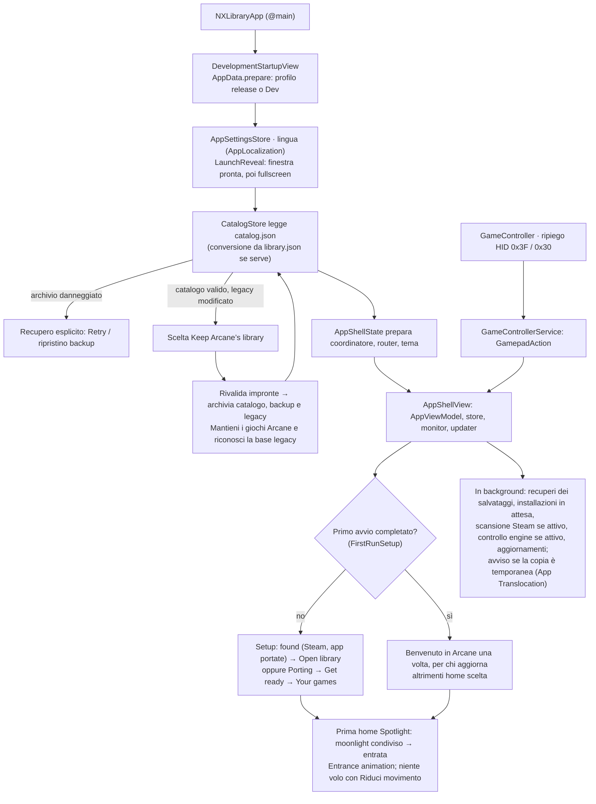
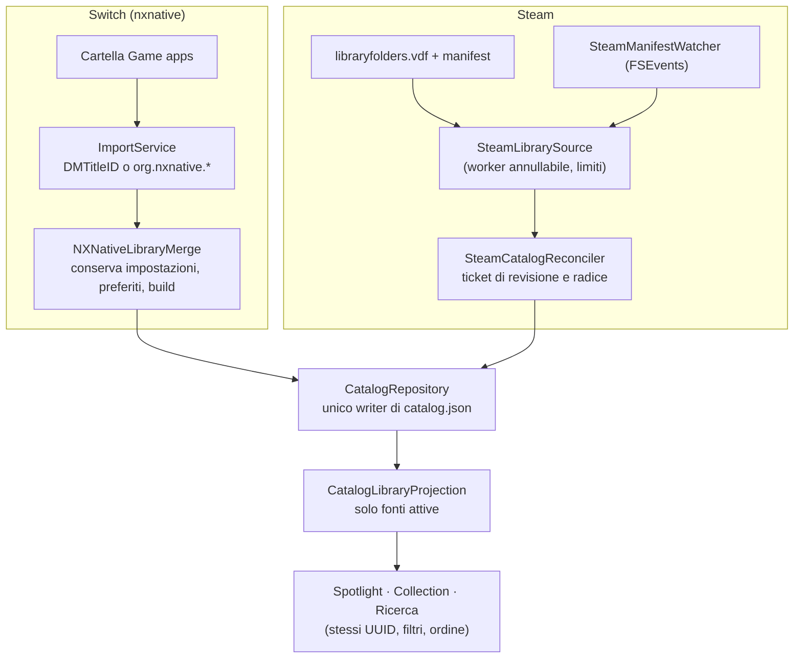
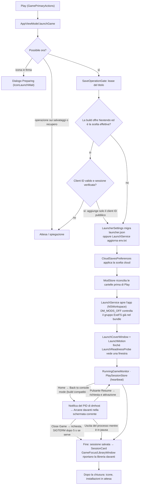
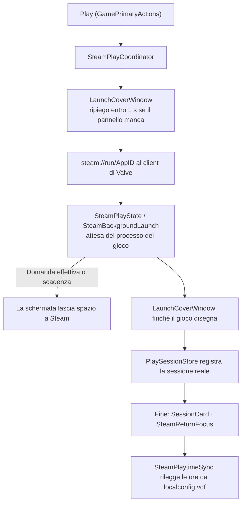
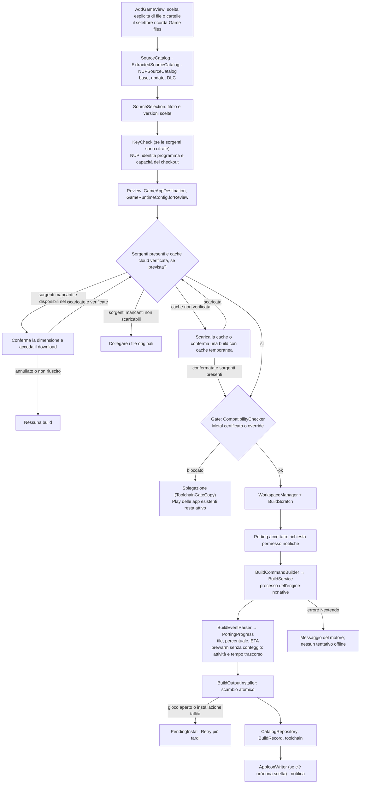
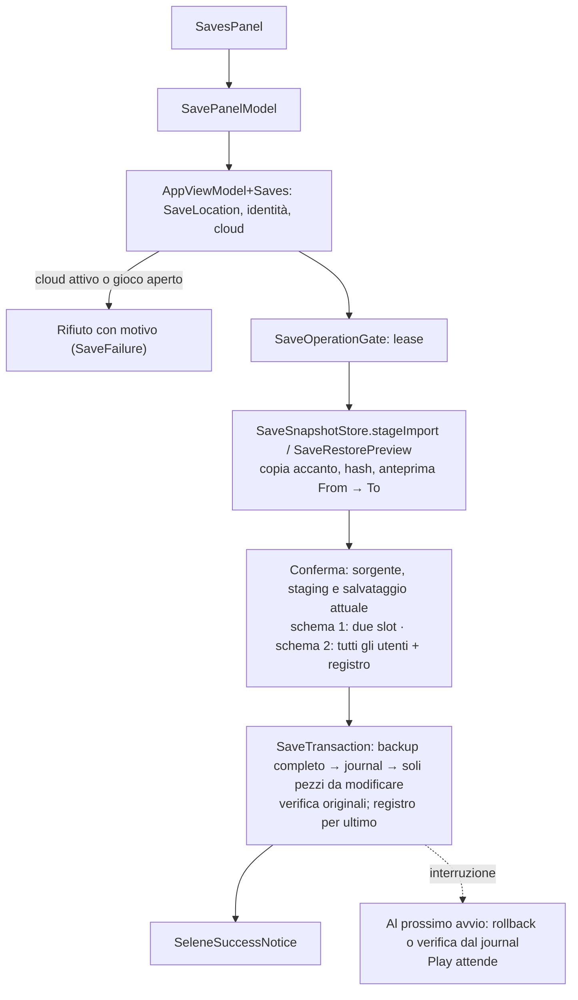
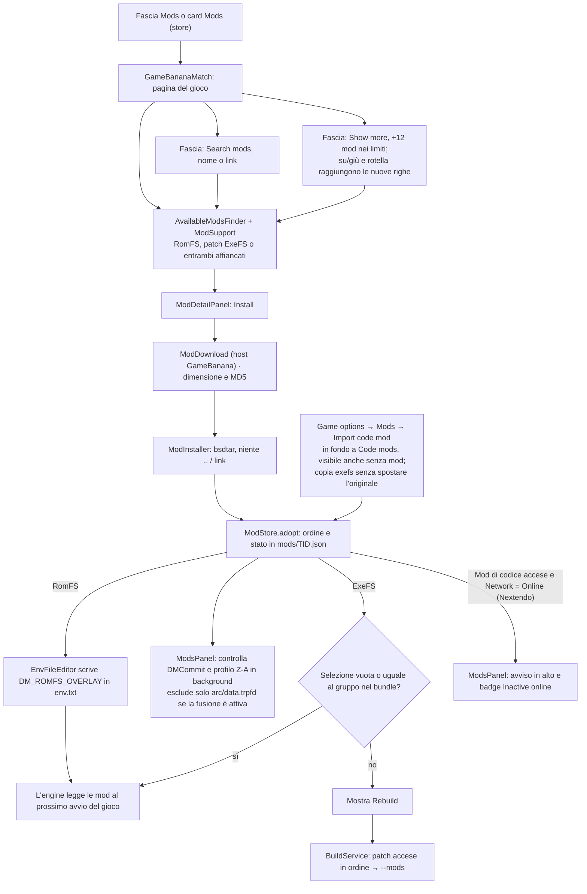
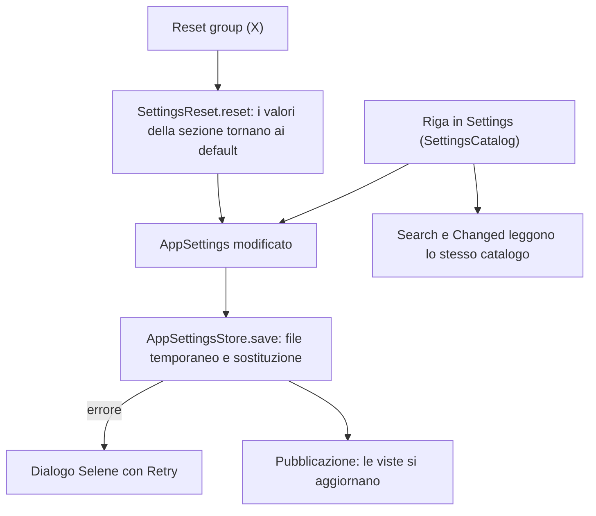
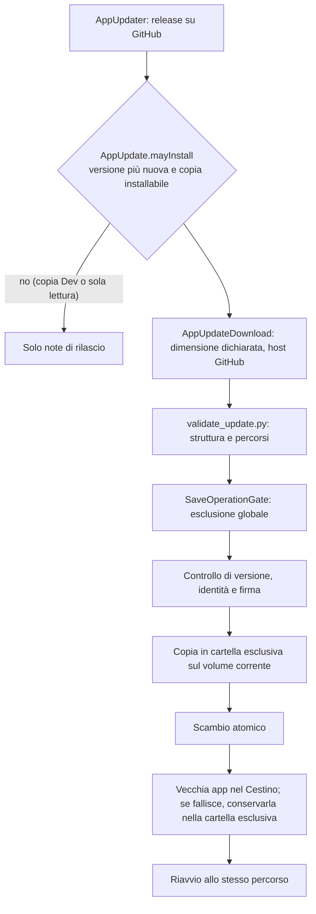

# Arcane — i flussi principali

Ogni flusso segue un'azione dall'input all'effetto, nominando i tipi che se ne occupano. I dettagli e le regole di ogni passo sono nella sezione dell'area in [architecture.md](architecture.md); come costruire un pezzo nuovo è in [conventions.md](../working-on-it/conventions.md). Se un flusso cambia, il suo schema si aggiorna nello stesso commit.

- [1. Avvio dell'app](#1-avvio-dellapp)
- [2. Dal disco alla libreria](#2-dal-disco-alla-libreria)
- [3. Play di un gioco Switch (nxnative)](#3-play-di-un-gioco-switch-nxnative)
- [4. Play di un gioco Steam](#4-play-di-un-gioco-steam)
- [5. Costruire un gioco Switch (Add Game)](#5-costruire-un-gioco-switch-add-game)
- [6. Importare o ripristinare un salvataggio](#6-importare-o-ripristinare-un-salvataggio)
- [7. Installare una mod](#7-installare-una-mod)
- [8. Cambiare un'impostazione](#8-cambiare-unimpostazione)
- [9. Aggiornare l'app](#9-aggiornare-lapp)

## 1. Avvio dell'app

Punti fissi:
- Gli store si costruiscono una volta sola, prima della shell.
- Un archivio illeggibile non diventa mai una libreria vuota.
- La Dev legge e scrive solo nel suo profilo.
- La scelta Steam del primo Setup resta salvata anche alla chiusura; lettura e attivazione usano la cartella scelta nella fonte. Una lettura incompleta offre Retry, senza dichiarare la libreria vuota.
- La cartella Game files ricordata resta una preferenza del selettore: l'avvio non ne enumera i sorgenti.
- La shell riceve gli stessi comandi dal profilo esteso GameController o, in sua assenza, da un pad HID Nintendo. Un pad dichiarato compatibile da macOS attende fino a due secondi prima del ripiego a HID.
- Menu e dialoghi nativi hanno precedenza sul routing della shell: `nativeDialogOwnsInput` ferma i comandi del controller anche se un benvenuto, Setup o dialogo dell'app è già aperto sotto.

## 2. Dal disco alla libreria

Punti fissi:
- Una scansione aggiorna solo ciò che ha osservato; un'assenza non cancella nulla.
- Un risultato superato da un cambio di cartella o di fonte non si applica.

## 3. Play di un gioco Switch (nxnative)

Subito prima del lancio, la modalità Gioco a distanza automatica aggiunge `DM_NET_VPN=1` solo con un unico candidato VPN IPv4 ZeroTier e una build che offre l'opzione. Nextendo, un valore esplicito per gioco o più candidati impediscono l'aggiunta. Il lancio non salva questa scelta.

## 4. Play di un gioco Steam

Arcane legge le domande dal log di Steam. Durante `ShowInterstitials` l'attesa prosegue e il client può aprire le sue finestre dietro la schermata. Arcane non scrive mai i file di Steam e non apre l'app del gioco direttamente. Dettagli in [steam.md](steam.md).

Nella pagina Spotlight di un titolo Steam, Giù porta anche a **More like this** quando la fascia è presente. Invio, A o doppio clic selezionano la copertina sulla riga della libreria. Se il filtro la esclude, la libreria passa a **All games** come per Switch.

## 5. Costruire un gioco Switch (Add Game)

`BuildCommandBuilder` aggiunge `--nextendo` e l'ID pubblico all'ambiente solo se il checkout dichiara il flag e l'ID è configurato. La sessione serve al Play online, non al porting.

Durante un porting, B o Esc nasconde il pannello senza annullare il lavoro. Dopo il completamento o l'annullamento, B o Esc torna a Review se c'è una selezione nel wizard; da un Build o Rebuild aperto direttamente senza bozza, torna alla schermata di partenza.

**Menu → Centro attività.** La campanella si apre con un clic o con la selezione del menu (Home sul controller, ⌘K da tastiera). Mostra il porting in corso e il collegamento alla sua schermata, il trasferimento cloud e le rispettive code. Su/Giù sposta il focus; Annulla ferma il lavoro attivo selezionato o rimuove la singola richiesta ancora in coda. B o Esc chiude il centro senza fermare i lavori.

Con un porting in corso, Build o Rebuild per un altro gioco accoda la richiesta; ripetere il comando per lo stesso gioco non crea duplicati. Spotlight e Details mostrano «Compilazione in coda» con Cancel, senza togliere Play dall'app già installata. Al successo, errore o annullamento del porting attivo parte il primo in attesa senza riaprire il pannello. Un titolo occupato da un trasferimento o da un lease aspetta il rilascio; un gioco rimosso o senza sorgenti recuperabili viene saltato con una nota nella Console. La coda del porting non sopravvive alla chiusura di Arcane.

**Details → Cloud.** Il badge accanto alle azioni principali e il link in fondo aprono lo stesso pannello; entrambi si possono nascondere in Settings. Al primo invio si scelgono app e cache insieme. Durante un invio completo la riga dell'app già inviata mostra «Sent · published when the upload ends» finché il manifest non è pubblicato. Una riga con copia locale disponibile, ambra o grigia, offre Send quando l'altro elemento ha già una copia cloud; Send update rimane disponibile quando entrambe le copie locali differiscono. Se il servizio richiede un nuovo invio congiunto, il pannello lo propone solo quando entrambe le copie locali sono disponibili. L'invio controlla spazio e inventari, verifica le copie Apple Archive in staging e pubblica il manifest dopo gli oggetti inviati. Se il confronto con l'elenco dell'archivio rileva una divergenza, il pannello indica il percorso relativo, la Console ne indica anche il motivo e non si pubblica un nuovo manifest.

Con solo una copia cloud dell'app, Download sostituisce il pulsante principale e usa lo stesso ripristino del pannello: verifica hash, inventario e firma prima di pubblicare la copia mancante e riattivare Play. Per un titolo importato da cloud, il download usa la cartella Game apps scelta senza richiedere sorgenti o una build. La terza riga propone Send o Download per i file del gioco mancanti da un lato; con una divergenza non offre alcuna azione.

Free up space apre una conferma con le dimensioni e una selezione per app, cache e file del gioco. Solo le copie sincronizzate sono selezionabili; app e cache partono selezionate quando disponibili, i file del gioco no. La conferma precede una nuova verifica prima del Cestino. La voce di libreria resta e lo spazio ritorna quando si svuota il Cestino. Invio, download e liberazione passano per la stessa coda. Cancel rimuove la richiesta in coda o annulla quella attiva; B chiude solo il pannello.

**Uscire durante un trasferimento.** Cmd+Q, Quit nella barra menu, Power → Quit e la chiusura della finestra principale aprono la stessa conferma nella finestra. Resta ha il focus iniziale: chiude la conferma e lascia proseguire il lavoro. Quit ferma il trasferimento, attende la scrittura della coda e poi chiude l'app. Al prossimo avvio riparte prima l'azione interrotta, poi quelle in attesa. Arcane salta i giochi non più in catalogo e le azioni non più possibili; per la liberazione parziale verifica di nuovo solo ciò che può ancora andare nel Cestino. L'aggiornamento resta bloccato mentre ci sono trasferimenti.

Se al Build o Rebuild mancano file locali ma il cloud li ha, Arcane mostra la dimensione da scaricare. Download accoda il ripristino e apre il pannello di avanzamento. Solo il ripristino riuscito nella stessa sessione riprende il percorso di build, con i normali controlli per cache e toolchain.

L'aggiornamento dello stato legge il manifest remoto mentre individua e controlla i percorsi locali. Se il demone rclone è indisponibile, i comandi singoli mantengono la distinzione tra copia assente e stato ignoto.

**File del gioco (Porting).** Data la selezione del gioco, `CloudGameSources` riusa i file remoti con MD5 uguale e invia solo gli assenti; una divergenza blocca un nuovo invio. La misura del download conta solo i file mancanti sul Mac con copia remota verificabile. Il ripristino pubblica ogni file verificato nella sua cartella locale già presente; la liberazione sposta nel Cestino solo i file locali appena verificati. Un annullamento non annulla i file già pubblicati o spostati nel Cestino.

**Settings → Porting → Cloud library.** Dal pannello Cloud, Open settings apre la sezione se la libreria è spenta o non configurata. In Connessione, Configure cloud library apre l'assistente. Una volta configurata, la sezione mostra servizio e cartella; Folder e Change Google credentials riaprono l'assistente. L'interruttore si applica senza riavvio. Aspetto cambia subito icona, link e badge con attenuazione delle copertine. Reset group ripristina solo queste scelte. Advanced si apre anche da un risultato pertinente in Search o Changed. Test connection legge soltanto l'elenco della cartella. Dopo conferma, Disconnect elimina solo il remote dal file rclone locale.

**Cambiare cartella cloud.** In Folder, l'assistente mostra i giochi della cartella precedente quando può spostarli. Se non si seleziona lo spostamento, Activate cambia solo la preferenza. Se lo si seleziona, Activate chiede conferma con numero di giochi e dimensione. La barra avanza per file e Cancel ferma il lavoro tra due file. Con un conflitto o un'interruzione, la preferenza resta invariata ma i file già spostati restano nella nuova cartella: ripetere la scelta con la stessa destinazione per completare. L'assistente mostra il numero dei file in conflitto e il primo percorso. La cartella di origine non viene rimossa.

Lo spostamento riguarda solo gli archivi app e cache e i manifest. I file del gioco restano dove sono. Connessione mostra entrambi i percorsi `remote:percorso`; da Game files folder si può impostare un percorso relativo sullo stesso remote senza spostare nulla. La riga compare in Search e, quando il percorso è esplicito, in Changed. Il percorso esplicito resta invariato al cambio della libreria; quello predefinito segue la libreria (`GameFiles`). Details → Cloud mostra il percorso di ogni cartella determinabile. I giochi con i file locali nella stessa cartella usano sottocartelle distinte sul remote, identificate dal title ID base.

**Importazione dalla libreria cloud.** All'avvio o alla fine dell'assistente, e quando si riattiva la libreria, Arcane cerca manifest validi e aggiunge i giochi mancanti senza scaricare app o sorgenti. Import games from the cloud in Connessione ripete la ricerca e mostra successo, assenza di nuovi giochi o errore. Un gioco rimosso esplicitamente resta escluso. Un titolo importato compare con badge solo cloud; Details → Download → Play resta lo stesso percorso.

## 6. Importare o ripristinare un salvataggio

## 7. Installare una mod

## 8. Cambiare un'impostazione

Nel menu rapido, Theme apre prima i colori con anteprima viva; A applica la palette e passa alla selezione dello sfondo. Il tema Arcane conserva il blu classico e l’identità predefinita `selene`; le alternative Arcane Crystal e Arcane Flow salvano `arcane-crystal` e `arcane-flow` nello stesso `colorThemeID`. La shell conserva un backdrop persistente; le pagine ne dichiarano stile, pausa e Mods con `SeleneBackdropRequest`, mantenendo artwork e maschere locali. La shell passa la palette completa in `SeleneBackdropStyle`: cambia il valore dell’ambiente e aggiorna sfondo e maschere anche senza spostare la selezione. La superficie usa lo stesso renderer, con orologio e regole di pausa condivisi. Le particelle sono sempre morbide, senza una scelta aggiuntiva. La scelta dello sfondo mantiene il dialogo di destinazione esistente.

La barra laterale segue `SettingsSidebarGroup`: General, Library, Porting e System. Ogni sezione mostra solo le righe di `SettingsCatalog` che le appartengono.

In General → Online services, un checkout con supporto Nextendo mostra la scheda account, Amici e l'ID client pubblico avanzato. La scheda legge l'account all'apertura, al completamento di Sign in e con Check status, senza polling. In Amici si può mandare una richiesta con un codice o da Giocatori recenti, accettare o rifiutare una richiesta ricevuta e rimuovere un amico dopo conferma. Le richieste inviate restano in attesa e non hanno azioni. Il risultato compare nel pannello e una scrittura confermata ricarica le liste; se la rilettura fallisce o l'esito è incerto, Check status rilegge senza reinviare. Il codice personale si può copiare e il profilo si può ancora aprire nel browser. Le letture in corso si annullano quando si lascia la pagina; una rotazione già avviata termina per conservare il token condiviso.

Sign in apre il browser predefinito e la riga offre Cancel finché attende la callback loopback. Una callback valida porta allo scambio PKCE e allo store condiviso del motore; Sign out rimuove solo il token locale. In Game Options → More settings, Network conserva solo le modalità dichiarate dal bundle del gioco.

Gioco a distanza mostra lo stato ZeroTier e offre Scarica o Apri. Gioco a distanza tramite ZeroTier alterna Automatico e Disattivato; Reset group torna ad Automatico.

In System → About, il pulsante Support Arcane compare tra il riepilogo dell’app e i crediti. `SettingsAboutSection` apre la pagina Buy Me a Coffee nel browser predefinito tramite clic, Invio o conferma del controller.

Tornando alla home, le viste delle tessere ricreate leggono subito le immagini decodificate in `TileArtMemo`; i task caricano quelle mancanti e rivalidano i file Steam. La cover della card Mods resta nel `ModStoreHost` posseduto dalla shell ed è rivalidata in background rispetto agli abbinamenti correnti.

## 9. Aggiornare l'app

Alla chiusura successiva, una copia release che si chiama ancora `NX Library.app` diventa `Arcane.app` (`AppBundleRename`, chiamato da `AppDelegate.applicationWillTerminate`). Non succede se un riavvio è in programma, perché l'aiuto che riapre l'app usa il percorso attuale.
